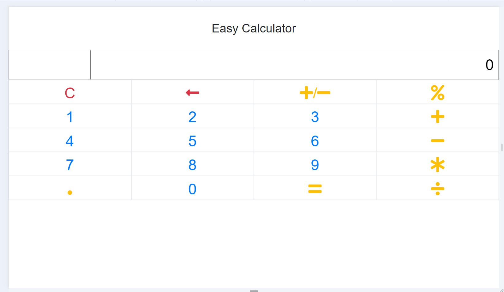
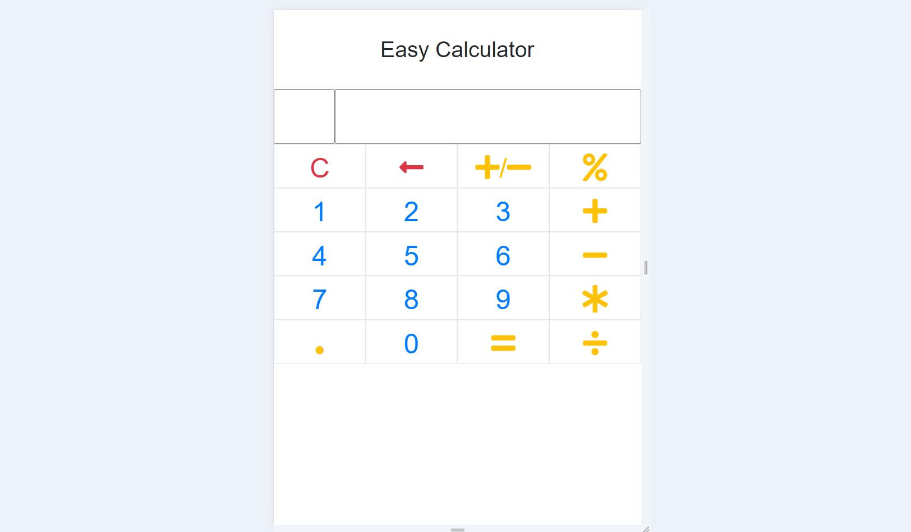

# Easy Calculator

[](https://github.com/ysskrishna/easy-calculator-react/blob/master/LICENSE) [](https://ysskrishna.space)

A simple responsive calculator app built using reactjs.

## Project setup
```
npm install
```

### Compiles and hot-reloads for development
```
npm run start
```

### Compiles and minifies for production
```
npm run build
```

# Images

## Desktop version:


## Tablet version:


## Built and maintained by

Easy Calculator is built and maintained by:

| | Name | GitHub | Role |
|---|------|--------|------|
|  | **Y. Siva Sai Krishna** | [@ysskrishna](https://github.com/ysskrishna) | Creator |

## Support

If you find this project helpful:

- ⭐ Star the repository
- 🐛 [Report issues](https://github.com/ysskrishna/easy-calculator-react/issues)
- 🔀 Submit pull requests
- 💝 [Sponsor on GitHub](https://github.com/sponsors/ysskrishna)

## License

MIT © [Y. Siva Sai Krishna](https://github.com/ysskrishna) — see [LICENSE](LICENSE) for details.

---

<p align="left">
  <a href="https://github.com/ysskrishna">Author's GitHub</a> •
  <a href="https://linkedin.com/in/ysskrishna">Author's LinkedIn</a> •
  <a href="https://ysskrishna.space">Author's site</a> •
  <a href="https://github.com/ysskrishna/easy-calculator-react/issues">Report Issues</a>
</p>
